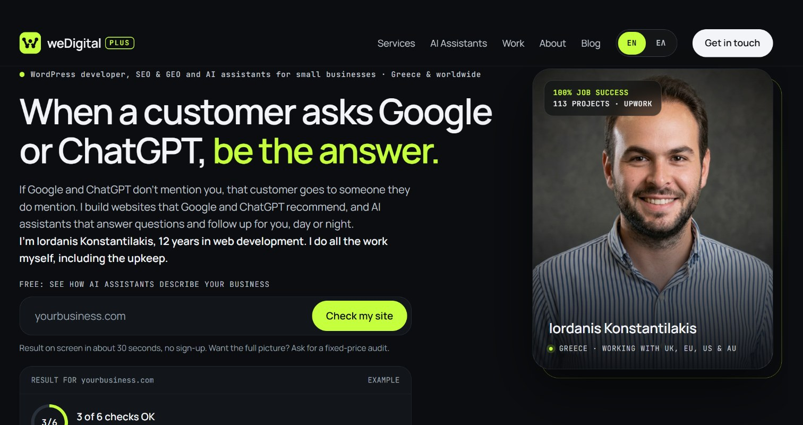
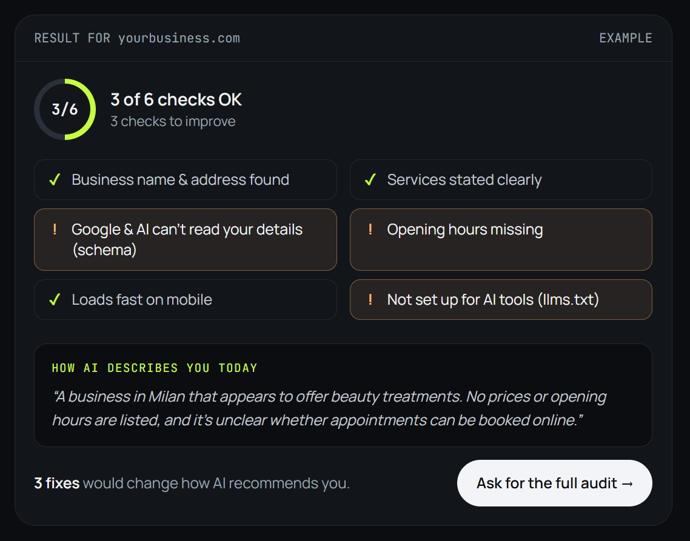

# AI Visibility Check

**A free tool that shows a small business how AI assistants like ChatGPT describe it today, and what to fix first.**

Try it live: **[wedigitalplus.com](https://wedigitalplus.com/#hero)** (English) · **[wedigitalplus.com/el](https://wedigitalplus.com/el/#hero)** (Greek)

## What it does

A visitor types their website address. In about a minute, with no sign-up, they get:

1. **Ten technical checks** on the homepage (the tool also reads up to three more pages, such as contact, about and services or prices): can search engines index it, HTTPS, load speed, mobile layout, page title and description, visible contact details, business structured data (schema), whether `robots.txt` lets AI assistants in, sitemap, and `llms.txt`.
2. **How an AI assistant would describe the business**, written by Claude after reading those pages and searching the web for what other sites say about it.
3. **What happens when a customer asks.** The tool asks two questions a real customer would ask, without mentioning the website, to Claude and to ChatGPT, each with live web search. It shows whether each assistant named the business and which businesses it named instead.
4. **The three fixes that matter most**, in plain language.
5. **One ready-to-use text**: a short description for the Google Business Profile, in the language of the business's customers, with a Copy button.

The result can also be sent by email as a formatted report, in English or Greek.

*The example above is the demo panel shown before a visitor runs a check.*

## How it works

- **WordPress plugin**, PHP 8.1+, vanilla JavaScript front end, no external libraries.
- **Three AI steps.** A research step (Anthropic API) reads the page data and runs a few web searches; the customer questions go to Claude and, through the OpenAI API, to ChatGPT, in parallel; a writing step turns everything into a short, plain-language result.
- **Bilingual** (English and Greek) for the interface, the AI result and the emailed report.

## Built to be accurate

Most of the work went into making the result *correct*, not just fluent. A few of the rules the AI follows, each one added after a real test went wrong:

- It reads a few pages, not the whole site, so it never claims a page or detail is missing from the site; it says "not found on the pages checked" instead.
- Honest counts only: "named in 1 of 2 answers", from real answers on that day. No score out of ten, no predicted result "after the fixes", and a note that answers change from one day and one assistant to the next.
- A business name appears in the ranking only if it is really written in the assistant's answer; the code checks this itself and does not take the AI's word for it.
- The ready-to-use text uses only facts found on the website, leaves out phone numbers and links, and is marked as a draft to check.
- Businesses with similar names are not mixed in: a fact from another site only counts if it matches the same domain, phone or address.
- The same phone number written with different spacing or country code is not reported as an inconsistency.
- Blocking only AI *training* crawlers is not the same as blocking AI assistants, and the result says so.
- Old pages that only exist in search results are described as old, not as what the site says today.
- It never invents a missing Google Business Profile, and never recommends tricks such as self-review stars or FAQ markup for rich results that Google no longer shows.

## Built to be safe

- Only public websites are fetched, on standard ports, with redirects checked again at each step. IP addresses, localhost and addresses with credentials are refused.
- Page text and search results are treated as untrusted data in the prompts, and the result is shown as plain text.
- Daily limits for the whole site and per visitor, results reused for a few days per address, and a check that fails does not count against the visitor.
- The API keys are stored in the WordPress settings, never in code.

## About the code

The source code is private. This repository describes the tool and shows what it does.

If you want a check like this on your own website, branded for your business, or a different AI tool built for it, get in touch: **[wedigitalplus.com](https://wedigitalplus.com/#contact)** · [LinkedIn](https://www.linkedin.com/in/iordanis-konstantilakis/)

---

**Ελληνικά:** Δωρεάν έλεγχος που δείχνει σε μια μικρή επιχείρηση πώς την περιγράφουν σήμερα οι AI βοηθοί όπως το ChatGPT και τι να διορθώσει πρώτα. Δοκιμάστε τον στο [wedigitalplus.com/el](https://wedigitalplus.com/el/#hero).

Built by Iordanis Konstantilakis, weDigitalPLUS, Greece.
